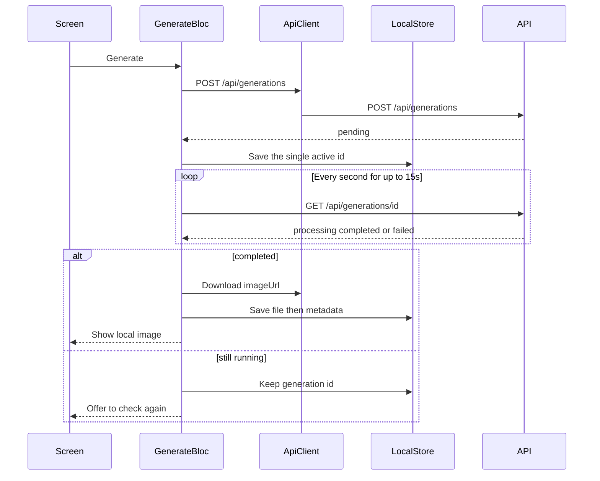

# Architecture

Источник: `docs/requirements.md` и подтверждённые уточнения к архитектуре. Документ фиксирует устройство AI Image Generator для одного разработчика и 5–8 часов.

## Подтверждённые решения

- Сервер: Python, FastAPI, SQLite, один контейнер. Запуск — `docker compose up --build`.
- `POST` создаёт генерацию со статусом `pending` и сроком `ready_at`. До срока `GET` возвращает `processing`. После срока повторные `GET` возвращают тот же конечный результат: PNG копируется один раз, статус больше не меняется. Фонового воркера нет.
- Prompt `trigger-error` завершается статусом `failed`. Завершающий `GET` возвращает `200` и код `GENERATION_FAILED`. HTTP `500` оставлен для настоящего сбоя сервера.
- Плейсхолдер — PNG из репозитория, выбранный по стилю. При завершении файл копируется в каталог данных под ID генерации.
- У клиента три состояния подписки: `unknown`, `free`, `premium`.
- Экран истории читает только локальные данные. Серверная история хранится отдельно и с клиентом не сливается. Это объясняется в README.
- Одновременно допускается только одна активная генерация. Её ID записывается сразу после успешного `POST`. Одна попытка ожидания длится 15 секунд. При запуске сохранённый ID не опрашивается сам: клиент предлагает продолжить ожидание.
- После покупки выбранная Premium-опция сохраняется, пользователь возвращается к генерации с ней.
- Повторный `POST /api/subscription/purchase` идемпотентен.
- После рестарта незавершённая генерация завершается по сохранённому `ready_at`.
- Записи генераций и подписка изолированы по `userId`.
- Premium проверяется до создания записи генерации.

## 1. Компоненты

Клиент и сервер — два процесса.

**Клиент**

- Оболочка держит три вкладки: генерация, история, настройки. Paywall — модальный лист. Вкладки остаются в памяти, поэтому prompt и текущий опрос не сбрасываются при открытии истории.
- **GenerateBloc** проводит одну попытку генерации: создаёт запрос, опрашивает статус и обрабатывает конечный ответ. Состояния экрана: `idle`, `inProgress`, `success`, `failure`. Серверные `pending` и `processing` для пользователя — одно ожидание.
- **ApiClient** знает адреса, заголовок `X-User-Id`, разбор ответов и скачивание байтов картинки.
- **LocalStore** хранит идентичность, кэш подписки, один ID активной генерации, метаданные истории и файлы картинок. Запись файла и строки истории выполняет один его метод.
- **SubscriptionBloc** держит `unknown`, `free` или `premium`, покупает Premium и повторяет запрос статуса из настроек.
- **HistoryBloc** читает локальный список.
- Настройки показывают данные SubscriptionBloc, `userId` и версию. Отдельного bloc у них нет.

**Сервер**

- API проверяет запрос и подписку, создаёт генерацию и вычисляет её статус по `ready_at`.
- SQLite хранит пользователей, подписку, генерации и ссылки на результаты.
- Каталог плейсхолдеров лежит в репозитории. Готовый файл копируется в каталог данных.

GenerateBloc не пишет файлы и SQL. После `completed` он просит ApiClient скачать `imageUrl`, затем просит LocalStore сохранить байты и метаданные. Отдельного repository-слоя нет.

Страница генерации сама открывает Paywall. Bloc-и друг друга не вызывают.

## 2. Ответственность

- Экран генерации хранит prompt и выбранные опции, показывает лоадер, результат, ошибку, повтор и продолжение проверки по сохранённому ID.
- GenerateBloc отвечает за порядок запросов одной попытки и за решение, каким состоянием она закончилась.
- ApiClient отвечает за HTTP, включая скачивание картинки.
- LocalStore отвечает за локальную долговечность: `userId`, кэш подписки, активный ID, история и файлы.
- SubscriptionBloc отвечает за три состояния подписки и покупку.
- HistoryBloc отвечает за чтение локальной истории.
- API отвечает за `400`, `403`, сроки генерации, `200` со статусом `failed` и настоящий `500`, если сервер не смог обработать запрос.
- SQLite сервера отвечает за состояние, которое переживает рестарт процесса.

Причина разделения GenerateBloc и LocalStore: попытка опроса и запись результата меняются по разным причинам. Метод LocalStore собирает скачивание байтов и локальную запись без нового слоя.

## 3. Потоки

**Запуск.** До первого кадра LocalStore читает `userId`, кэш подписки и ID активной генерации. Если `userId` нет, клиент создаёт UUID. Если ответ о подписке ещё не сохранён, состояние — `unknown`: серверный Free нового пользователя клиент себе не копирует. Бесплатная генерация при этом доступна. Затем в фоне вызывается `GET /api/subscription`. Успех переводит кэш в `free` или `premium`. Сетевая ошибка оставляет `unknown`. Если в LocalStore есть ID активной генерации, экран предлагает продолжить ожидание. Опрос сам не начинается: это закрывает случай, когда приложение закрылось во время polling.

**Одна активная генерация.** LocalStore хранит не больше одного ID. Пока он записан, новая генерация не создаётся. ID появляется сразу после успешного `POST` и исчезает, когда клиент сохранил `completed` или показал конечную ошибку. Поэтому закрытие приложения во время опроса не теряет генерацию, а вторая параллельная генерация не начинается.

**Бесплатная генерация.** Сервер сначала проверяет поля. Пустой prompt или неизвестное значение даёт `400`, запись не создаётся. Допустимый запрос записывается как `pending` со сроком `ready_at` примерно через 3 секунды. Клиент сохраняет этот ID как единственный активный, сразу читает статус и дальше опрашивает его раз в секунду, но не дольше 15 секунд за одну попытку. До срока сервер возвращает `processing`. После срока один раз копирует PNG выбранного стиля в `data/images/{id}.png`, сохраняет относительный путь и возвращает `completed` с `imageUrl`. Повторный `GET` отдаёт тот же ответ. ApiClient скачивает байты. LocalStore сначала записывает файл, затем метаданные, и очищает активный ID. Экран показывает файл с устройства.

**Таймаут ожидания.** Если за 15 секунд конечного статуса нет, ID остаётся в LocalStore. Экран показывает, что проверка прервана, и предлагает продолжить её. То же предложение появляется при следующем запуске, если приложение закрылось во время polling. Продолжение начинается только по явному действию пользователя и опрашивает тот же ID ещё 15 секунд. Серверная генерация из-за остановки клиента не отменяется: следующий `GET` по-прежнему завершает её по `ready_at`.

**Premium при известном Free.** Нажатие на Anime, Cinematic или HD открывает Paywall и не отправляет генерацию.

**Premium при unknown.** Нажатие не считает пользователя Free и не открывает Paywall сразу. Клиент запрашивает `GET /api/subscription`. Ответ Premium выбирает опцию. Ответ Free открывает Paywall и сохраняет `free`. Ошибка запроса оставляет `unknown` и показывает восстановимую ошибку проверки.

**Покупка.** `POST /api/subscription/purchase` сохраняет Premium. Повторный вызов для того же `userId` снова возвращает Premium и не создаёт вторую подписку. Клиент обновляет кэш, оставляет выбранной опцию, с которой открылся Paywall, закрывает лист и возвращает пользователя к генерации.

**Обход интерфейса.** Premium-запрос при Free проверяется до `INSERT`. Сервер возвращает `403` и `PREMIUM_REQUIRED`, записи нет. Клиент ставит кэш в `free` и открывает Paywall.

**trigger-error.** Запрос проходит обычную проверку и создаёт генерацию. На сроке `ready_at` завершающий `GET` возвращает `200`:

```json
{
  "id": "generation-uuid",
  "status": "failed",
  "error": {
    "code": "GENERATION_FAILED",
    "message": "Image generation failed"
  }
}
```

Экран показывает ошибку и кнопку Retry. Prompt и опции остаются. Retry по явному нажатию отправляет новый `POST` и создаёт другую генерацию. Bloc сам запрос не повторяет, поэтому `trigger-error` не уходит по кругу. HTTP `500` клиент тоже показывает как восстановимую техническую ошибку с тем же явным Retry, но сценарий `trigger-error` этот ответ не использует.

**История.** Экран читает локальную SQLite и локальные файлы. `GET /api/generations` существует, отдаёт историю только этого `userId` и нужен, чтобы серверное состояние можно было проверить. Клиент этот список не забирает и не сливает с локальным.



## 4. Данные

**Серверная SQLite**

- Пользователь: `userId` и статус Free или Premium. Первый запрос с новым ID создаёт Free.
- Генерация: `id`, `userId`, prompt, style, aspect ratio, quality, статус, `ready_at`, ссылка на результат и код ошибки. Чтение и список фильтруются по `userId` из `X-User-Id`. Чужой или неизвестный ID возвращает `404`.

**Файлы сервера**

- `backend/assets/` — исходные PNG по стилям.
- `backend/data/` — файл SQLite и `images/{id}.png`. Каталог подключён к контейнеру, поэтому рестарт его не стирает.
- В базе лежит относительный путь `/static/generated/{id}.png`. Клиент собирает адрес запроса из baseUrl и этого пути.

`GET` не хранит срок в памяти. Если процесс поднялся заново и `ready_at` уже прошёл, первый такой `GET` переводит `pending` или `processing` в `completed` либо `failed`. Переход копирует PNG один раз. Следующие `GET` возвращают сохранённый статус и ту же ошибку или ту же ссылку. Зависнуть в `processing` после рестарта генерация не может.

**Локальная SQLite**

- `userId`.
- Кэш подписки: `unknown`, `free`, `premium`.
- Один ID активной генерации. Он записывается сразу после успешного `POST` и удаляется после сохранённого `completed` или показанной конечной ошибки.
- История: prompt, параметры, дата, статус, имя файла.

**Файлы приложения**

- Скачанные изображения. Экран использует `Image.file`.
- Для `failed` сохраняются метаданные без файла.

## 5. Граница

Сервер решает, корректен ли запрос, разрешена ли Premium-опция, наступил ли `ready_at` и какая ссылка ведёт на файл. Клиент решает, что показать до ответа сервера и что останется без него.

`unknown` означает, что успешного ответа о подписке ещё не было. Бесплатные опции работают. Premium-опция в этом состоянии запускает проверку, а не сценарий Free. `free` и `premium` используются только после ответа сервера или после `PREMIUM_REQUIRED`.

Ошибка сети при обновлении подписки не переписывает известный статус в `unknown` и не превращает `unknown` в `free`.

## 6. Ошибки и восстановление

Форма генерации сохраняется. Продолжение проверки и Retry — разные явные действия. Продолжение опрашивает сохранённый ID. Retry создаёт новую генерацию и отправляется только после нажатия кнопки.

- `400` — запись не создаётся, экран объясняет некорректный запрос.
- `403 PREMIUM_REQUIRED` — записи нет, кэш становится `free`, открывается Paywall.
- `200` и `failed` с `GENERATION_FAILED` — бизнес-ошибка генерации. Активный ID очищается. Новый запрос уходит только после нажатия Retry.
- `500` — технический сбой API. Экран показывает восстановимую ошибку. Для `trigger-error` этот ответ не используется.
- Сеть, не-JSON и `completed` без картинки — `failure`. LocalStore не записывает неполный результат.
- Таймаут 15 секунд и закрытие приложения во время polling — ID остаётся в LocalStore. Экран предлагает продолжить ожидание и не начинает его сам. Вторая генерация в это время не создаётся.
- Рестарт сервера во время ожидания — следующий `GET` завершает ту же строку по `ready_at`.

Кнопка в настройках повторяет `GET /api/subscription`. Её ошибка не подменяет уже известный статус.

## 7. Директории

```
frontend/
  lib/main.dart                         # userId и кэш до первого кадра
  lib/app.dart                          # вкладки и bloc-и
  lib/core/api_client.dart              # HTTP и скачивание картинки
  lib/core/local_store.dart             # SQLite, активный ID и файлы
  lib/features/generate/                # экран и GenerateBloc
  lib/features/history/                 # экран и HistoryBloc
  lib/features/subscription/            # SubscriptionBloc и Paywall
  lib/features/settings/
  ios/                                  # NSAllowsLocalNetworking для HTTP симулятора
backend/
  app/                                  # FastAPI и SQLite
  assets/                               # PNG по стилям
  data/images/                          # база и готовые файлы между рестартами
  tests/                                # контракт API
docker-compose.yml
```

Схема SQLite создаётся при старте процесса. Отдельная СУБД и отдельный шаг миграций не нужны.

iOS-симулятор ходит на `http://127.0.0.1:8000`. В `Info.plist` для локального HTTP включается `NSAllowsLocalNetworking`. Связку нужно проверить на симуляторе до сдачи: без этой настройки клиент может не открыть соединение с backend.

Контрактные тесты сервера проверяют изоляцию по `userId`, идемпотентную покупку, `403` без записи генерации, `200` со статусом `failed` для `trigger-error` и завершение просроченного `ready_at` новым подключением к той же базе.
